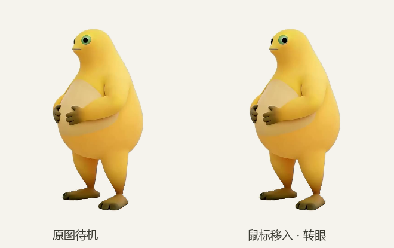
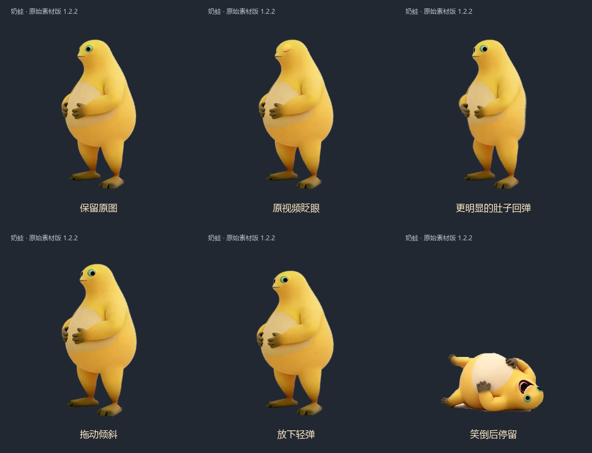
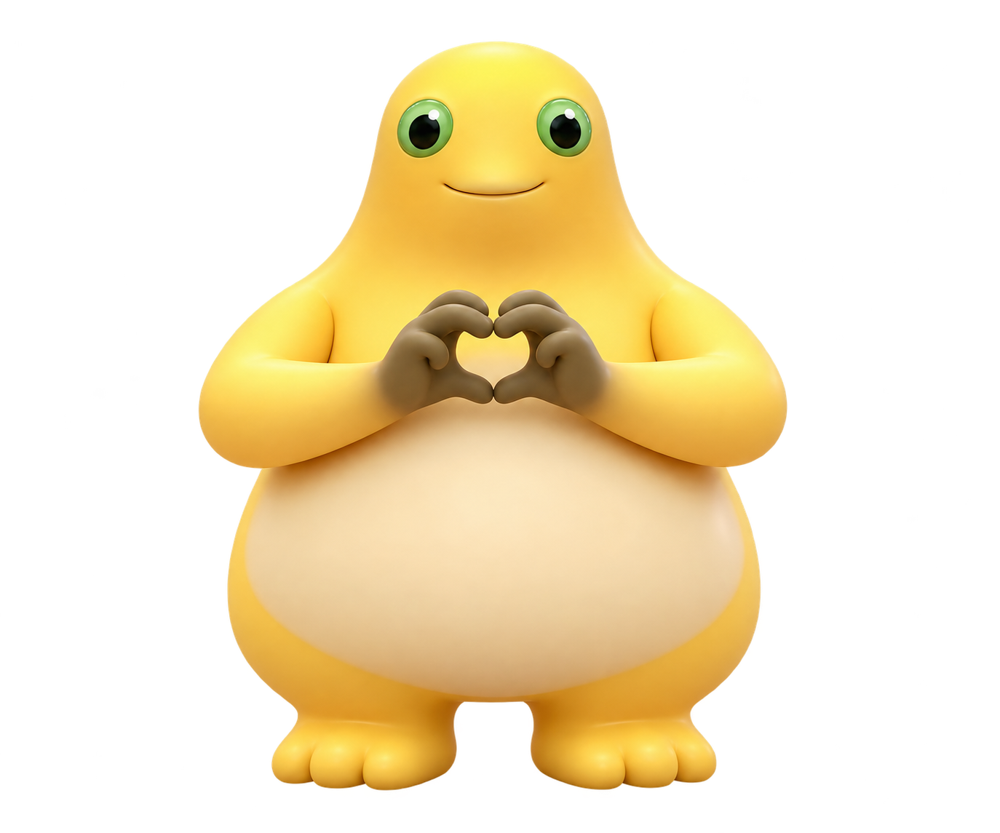
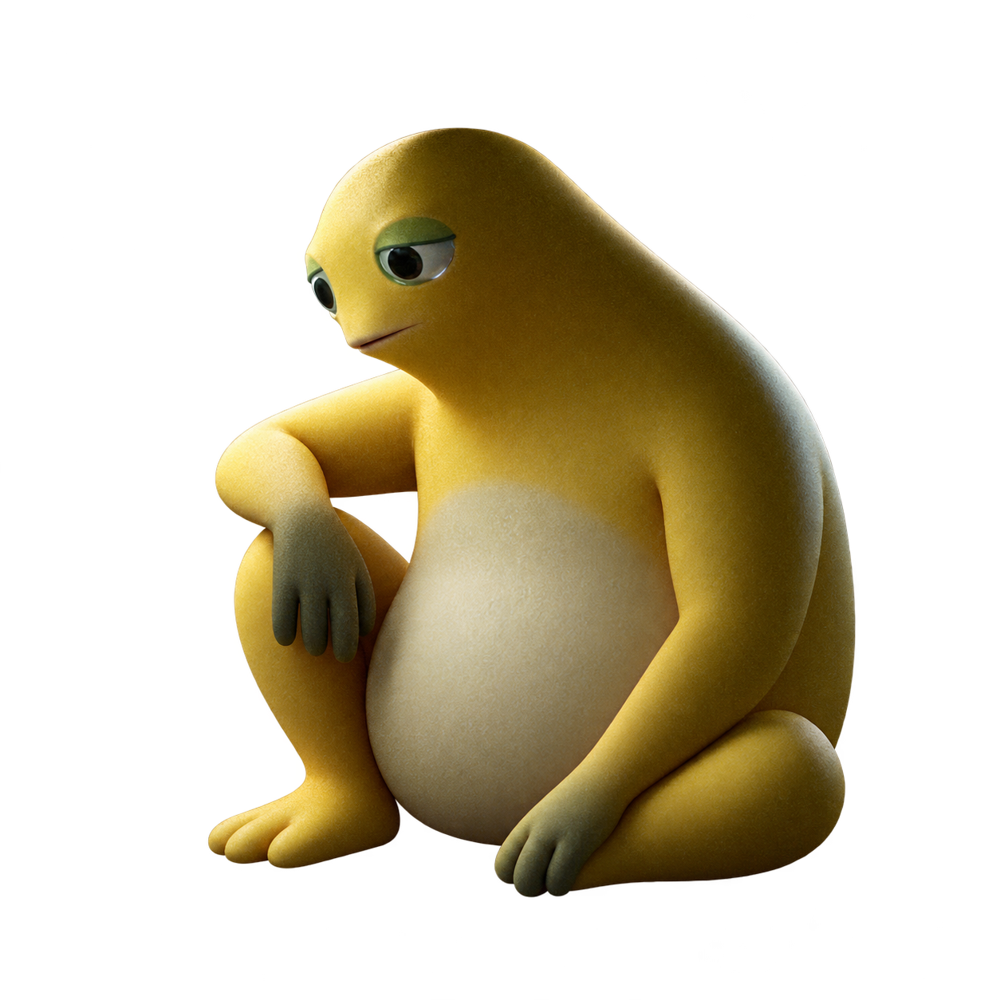

# 奶蛙桌宠 · Windows 桌面版

基础版来自 [yugh6 的 Naiwa 项目](https://github.com/yugh6/Naiwa)，感谢原作者 yugh6 分享奶蛙桌宠。我们在基础版上进行了二次创作，加入更多大小、表情动作与满屏效果。奶蛙可以眨眼、跟随鼠标转眼、戳肚子、拖动和捧腹大笑。

为改善放大后的清晰度，程序中的原始待机、转眼、眨眼和大笑帧已统一做 2× AI 超分辨率增强，画布从 288 × 368 提升到 576 × 736。处理使用面向动画视频帧的 [Real-ESRGAN AnimeVideoV3](https://github.com/xinntao/Real-ESRGAN)，细节由模型补全，和原始素材可能略有差异。

## 下载与安装

1. 在 GitHub 页面点 **Code → Download ZIP**，下载后先完整解压。若以后提供 Releases，也可下载其中的完整压缩包。
2. 保持 `奶蛙桌宠.exe`、`素材.nwp`、`原版笑声.wav`、`使用说明.txt` 和 `emotes/` 文件夹在同一目录。只复制 exe 会缺少素材。
3. 在 Windows 10 或 11 上双击 `奶蛙桌宠.exe`。程序使用 .NET Framework 4.x，本地运行，不需要登录或联网。
4. 右键奶蛙或任务栏通知区域中的奶蛙图标，打开动作与设置菜单。

也可以把本仓库链接复制给 WorkBuddy、Codex、豆包工作等工具，让它们按上述步骤下载完整文件并安装到 Windows 桌面。

重复启动程序不会生成第二只奶蛙，而会让已有的奶蛙回到鼠标所在屏幕的右下角。如果看不到它，也可以双击托盘图标找回。

## 玩法

| 操作 | 效果 |
| --- | --- |
| 鼠标靠近 | 转眼看向鼠标，平时会自然眨眼。 |
| 单击肚子 | 肚子凹下并回弹。 |
| 双击奶蛙 | 捧腹大笑；笑倒后单击可站起来。 |
| 左键拖动 | 移动位置；所有尺寸都能拖到屏幕边缘，部分藏到屏幕外。 |
| 右键 → 大小 | 小号 65%、标准 85%、大号 110%、Pro 150%、Max 200%、Pro Max 300%、大杯 600%、超大杯 700%。 |
| 右键 → 表情动作 | 比心、EMO 发呆、EMO 擦眼、靠墙抽烟、雨天撑伞、喝咖啡发呆、抱膝低落。 |
| 右键 → 停留当前动作 | 保持所选动作，直到选择「结束表情动作」。 |
| 右键 → 满屏 | 在鼠标所在的一个屏幕上，让不同大小、方向的奶蛙从上方落下。可选同一动作或混合动作；右下角的正常奶蛙用于右键关闭满屏效果。落完后可以点开其他窗口，让它显示在奶蛙前面。 |

可在菜单中开关原版笑声、置顶和全屏时自动隐藏。位置、大小和这些选项保存在 `%LOCALAPPDATA%\NaiwaDesktopPet\settings.ini`。

## 样例图

待机和转眼：

眨眼、拖动、笑倒等互动：

比心和 EMO 发呆素材：

 

## 从源码构建

在 Windows 上双击 `源码/build.cmd`，或在该目录执行它。构建脚本使用系统自带的 .NET Framework C# 编译器，将新 exe 输出到仓库根目录。运行时仍需要上面列出的素材文件。

## 文件说明

| 路径 | 用途 |
| --- | --- |
| `奶蛙桌宠.exe` | 主程序。 |
| `素材.nwp` | 原版图片、眨眼和大笑动作素材。 |
| `原版笑声.wav` | 大笑声音。 |
| `emotes/*.png` | 右键菜单中的表情动作图。 |
| `使用说明.txt` | 可从程序右键菜单打开的简要说明。 |
| `源码/` | C# 源码和构建脚本。 |

## 原项目与素材

基础版：[yugh6/Naiwa](https://github.com/yugh6/Naiwa)。感谢原作者 yugh6；这个 GitHub fork 保留原作者署名、项目链接和上游关系。原项目目前未附明确的开源许可证，因此本修改版也不擅自添加一个许可证；公开可查看源码不等于获得在 GitHub 之外再分发原版素材的授权。表情素材来源见 `emotes/CREDITS.txt`。如需在其他渠道发布安装包或给整个项目添加许可证，应先确认原作者及相关素材的授权。
